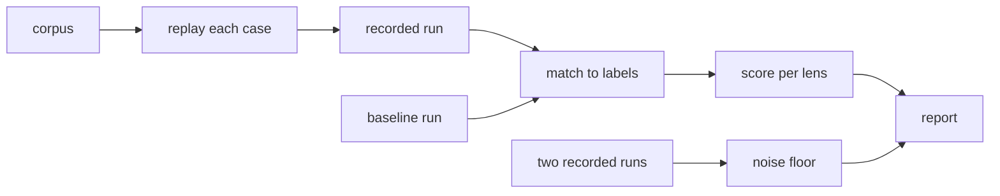

# The eval harness

The eval harness replays a corpus of past changes through noslop with the config under test, and
scores what noslop reports against the findings a reference reviewer made on those changes, each
labelled by what happened to it. `noslop eval --corpus <folder>` runs it from a repo whose config it
tests. The score is per lens, so a lens is measured on its own even when a call carries it with
others. A recorded baseline run scores beside noslop on the same cases, and two recorded runs of one
reviewer give the noise floor: the run-to-run difference below which a gap between two configs means
nothing. The harness reports counts and decides nothing; the person reading the report judges a
prompt, grouping or threshold change by them. [0012](../decisions/0012-the-findings-store.md)
records the harness.

[The pipeline](./pipeline.md) covers the review each case runs, and
[routing and depth](./routing-and-depth.md) covers the Light rule the report counts against.

## The corpus

A corpus is a folder with one folder per case, and each case folder holds its labels in a
`case.json`. The harness loads the cases in name order, so two runs replay them in the same order,
and skips a folder with no `case.json`. A case that fails its schema stops the load with the case's
name. noslop ships no corpus: each user builds one from their own past changes and keeps it outside
the repo.

A case holds the path to a local clone of the repo, the base and head commits of the change, its
title and body, the labelled findings, and the escapes. A labelled finding holds its anchor, title,
severity, the lens it belongs to when one fits, and its label: `true-positive`, `false-positive` or
`disputed`. An escape holds the defect, whether the diff showed it, and its anchor and lens when
they are known. Before a run, the harness resolves each labelled path to the file that the path
names at the head, because a reviewer that ran in a checkout folder records the path with that
folder's prefix, and a short path leaves out leading folders. A path that matches no file, or that
matches more than one, stays as the corpus wrote it.

## A run

The harness reviews the first cases of the corpus, all of them unless `--limit` caps the count. For
each case, noslop runs its whole pipeline on the case's clone, from the base to the head, with the
merged config of the working directory's repo and the adapter that config or `--adapter` names. The
pipeline checks out the head in a worktree of its own, so the clone's own checkout never moves. A
case that throws, or whose calls all fail, is recorded as failed, and the run goes on.

Each case that ends is written at once to `runs.json` in the out folder, which `--out` names or
which sits under the user's cache folder. A run cut short therefore keeps every case it finished.
The file is a recorded run, and a later eval reads it as a baseline or as half of a noise floor.
When the run ends, the harness writes the report as Markdown and the score as JSON beside it, and
prints one of them.

The harness also drives a reviewer that needs the head checked out for it: it adds a detached
worktree of the case's clone at the head and removes it after the review. A reference reviewer of
that kind is defined beside one of the model adapters, and no command runs it, so a baseline reaches
the harness as a recorded run passed by path.

## Matching

A reported finding matches a labelled finding on the same file when their line ranges sit within a
fixed window of each other. Each labelled finding takes at most one reported finding and each
reported finding at most one label. The closest pairs match first, then pairs whose lenses agree,
and augmenting paths then reassign matches until the window allows no more. Ties break on the
findings' content, so the result never depends on the order a reviewer listed them in. An escape
with an anchor matches reported findings the same way. An escape with no anchor can never be caught,
and it counts only toward the Light rule.

## The score

For each lens, the score holds:

- The true positives the corpus labels with the lens, and how many the run repeated with a finding
  of any lens.
- What the lens reported, split by the label of the finding each report matched: true positive,
  false positive or disputed.
- The findings the lens reported that matched no label.
- The escapes its findings caught.

A reported finding with no lens counts under `unknown`. The totals add the cases and failed cases,
the calls, the tokens in and out, and the duration. The Light rule section counts the cases noslop
reviewed at Light and the labelled P1 true positives and escapes those cases hold, which the rule in
[0007](../decisions/0007-depth-and-models.md) needs to stay near none.

With `--baseline <runs>`, the harness scores the recorded run on the cases of this run and prints
its totals in a second column. With `--noise-floor <first>,<second>`, it matches the two runs'
findings on each case that both completed, and reports the agreement: the matched findings over the
union of both runs' findings.

The harness writes the runs file again as each case ends, so a replay that stops keeps the cases it
finished. With `--resume`, a replay into the same out folder keeps those cases and replays only the
rest.
