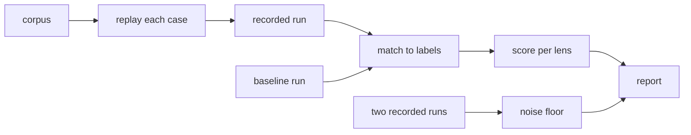

# The eval harness

The eval harness replays a corpus of past changes through noslop with the config under test, and
scores what noslop reports against the findings a reference reviewer made on those changes, each
labelled by what happened to it. `noslop eval --corpus <folder>` runs it from a repo whose config it
tests. The score is per lens, so a lens is measured on its own even when a call carries it with
others. A baseline is a recorded run, such as one of the reference reviewer, that the harness scores
beside noslop on the same cases. Two recorded runs of one reviewer give the noise floor: the
run-to-run difference below which a gap between two configs means nothing. The harness reports
counts and decides nothing; the person reading the report judges a prompt, grouping or threshold
change by them. [0012](../../decisions/0012-the-findings-store.md) records the harness.

[The pipeline](../review/pipeline.md) covers the review each case runs, and
[routing and depth](../review/routing-and-depth.md) covers the Light rule the report counts against.

## The corpus

An eval corpus is a labelled set of past changes, with the findings a reviewer made on them and the
escapes that got past review. On disk a corpus is a folder with one folder per case, and each case
folder holds its labels in a `case.json`. The harness loads the cases in name order, so two runs
replay them in the same order, and skips a folder with no `case.json`. A case that fails its schema
stops the load with the case's name. noslop ships no corpus: each user builds one from their own
past changes and keeps it outside the repo.

A case holds the path to a local clone of the repo, the base and head commits of the change, its
title and body, the labelled findings, and the escapes. A case may also hold the text of its linked
issue, which the intent lens needs to run, and the head an earlier review of the pull request
covered. A case with that reviewed head is a re-review: each reviewer replays it from the reviewed
head, so the diff holds only the push to the files the change makes since its base, and noslop runs
it as the [re-review](../output/github-app.md#re-review-and-fix-confirmation) of a live pull
request, with the description left unjudged. A labelled finding holds its anchor, title, severity,
the lens it belongs to when one fits, and its label: `true-positive`, `false-positive` or
`disputed`. An escape holds the defect, whether the diff showed it, and its anchor and lens when
they are known.

A case may also hold silences, each a lens it expects to report no finding, with the reason and,
when the silence holds only near some lines, an anchor. A silence turns a check against a false
positive into a scored expectation.

Before a run, the harness checks that each labelled path names a file at the case's head, and it
stops with the case and the paths when one does not, because a label on a missing file can never
match. A case whose clone or head it cannot read skips the check, and the replay records that case
as failed.

A fix-check case measures the fix check in place of the lenses. A case is a fix-check case when it
holds `fixes`: the findings an author replied `fixed` to, and for each one the verdict it expects,
`fixed` or `not-fixed`. The harness runs no lens on it. It runs the
[fix check](../output/fixes-only-run.md) of each finding at the case's head, with the case's base as
the merge base, as a fixes-only run of a live pull request does. The run records each verdict and
its reason. A fix check that fails, or that gets no call because the fix goes over the config's file
limit, records no verdict, and the report shows it as `unjudged`. The report lists each verdict
beside the one the case expects, in a section of its own. A fix-check case counts in the totals'
cases, calls, tokens and duration, and in no lens row.

## A run

The harness reviews the first cases of the corpus, all of them unless `--limit` caps the count. For
each case, noslop runs its whole pipeline on the case's clone, from the base to the head, with the
merged config of the working directory's repo and the adapter that config or `--adapter` names. The
pipeline checks out the head in a worktree of its own, so the clone's own checkout never moves. A
case that throws, or whose calls all fail, is recorded as failed, and the run goes on. A `repo:`
rules path reads from the case's clone, as a live review of that repo reads it.

Each case that ends is written at once to `runs.json` in the out folder, which `--out` names or
which sits under the user's cache folder. A run cut short therefore keeps every case it finished.
Each finding in it keeps its criterion and the rule it cites, so a run can count the findings that
rest on each rule. A noslop case also keeps each finding Assemble dropped, with the reason and the
rule and quote it cited, so a run shows whether the quote check drops real findings. It keeps the
lenses of its calls that errored or timed out as well, so the score can tell a silent lens from one
that never ran. The file is a recorded run, and a later eval reads it as a baseline or as half of a
noise floor. When the run ends, the harness writes the report as Markdown and the score as JSON
beside it, and prints one of them.

No command runs a reference reviewer, so a baseline reaches the harness as a recorded run passed by
path.

## Matching

A reported finding matches a labelled finding on the same file when their line ranges sit within a
fixed window of each other. Each labelled finding takes at most one reported finding and each
reported finding at most one label. The closest pairs match first, then pairs whose lenses agree,
and augmenting paths then reassign matches until the window allows no more. Ties break on the
findings' content, so the result never depends on the order a reviewer listed them in. An escape
with an anchor matches reported findings the same way. An escape with no anchor can never be caught,
and it counts only toward the Light rule.

A silence takes no part in that pairing, because one finding can break a silence and match a label
at once. A finding breaks a silence when its lens is the silence's lens and, for a silence with an
anchor, it sits on the anchor's file within the window. A silence with no anchor breaks on a finding
of its lens anywhere in the change.

## The score

For each lens, the score holds:

- The true positives the corpus labels with the lens, and how many the run repeated with a finding
  of any lens.
- What the lens reported, split by the label of the finding each report matched: true positive,
  false positive or disputed.
- The findings the lens reported that matched no label.
- The escapes its findings caught.
- The silences the corpus expects of the lens, and how many of them it broke. A silence counts once,
  as kept or broken, however many findings break it, so it reads as a pass or a miss beside the
  count of findings reported. A silence goes unscored on a failed case, and on a case where a call
  that carried its lens errored or timed out, because a lens that never ran would keep it.

A reported finding with no lens counts under `unknown`. The totals add the cases and failed cases,
the calls, the new input, cached input, cache write and output tokens that
[adapters](../review/adapters.md) defines, and the duration. The Light rule section counts the cases
noslop reviewed at Light and the labelled P1 true positives and escapes those cases hold, which the
rule in [0007](../../decisions/0007-depth-and-models.md) needs to stay near none.

With `--baseline <runs>`, the harness scores the recorded run on the cases of this run and prints
its totals in a second column. With `--noise-floor <first>,<second>`, it matches the two runs'
findings on each case that both completed, and reports the agreement: the matched findings over the
union of both runs' findings.

The harness replays cases at the same time, up to the config's parallel case limit, and keeps the
runs in the corpus's order whatever order they end in. It writes the runs file again as each case
ends, so a replay that stops keeps the cases it finished. With `--resume`, a replay into the same
out folder keeps those cases and replays only the rest.

With `--depth light|standard|deep`, the harness reviews every case at that depth in place of the one
the risk score picks, so two runs of one corpus at two depths show what the deeper review finds that
the other misses. A special route still runs no call.

## The static depth replay

With `--static`, the harness plans each case with the config under test and makes no model call: it
reads the change, runs the static stage and routes it, which is the part of a review that needs no
model. Routing and the risk score are deterministic, so the replay runs on a whole corpus with no
model cost and tells what a change to the risk score's thresholds does before any model run.

The report counts the cases at each depth, the labelled P1 true positives and the escapes those
cases hold, and the calls each depth plans. It lists every labelled P1 and escape on a case that
routes to Light, because each one is a defect the Light rule lets through with the least effort. It
gives each case its planned calls and the most calls its review can make once the passes count: the
merge pass when the config turns it on. A label's anchor plays no part, so the replay skips the
check that each labelled path names a file.
