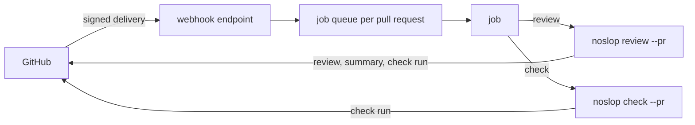

# The GitHub App

noslop posts on a pull request as its own GitHub App and sets a check run named `noslop`. For each
review, the GitHub adapter posts one pull request review with an inline comment per new finding,
folds a large class of like findings into one comment, writes one summary comment, and sets the
check run. The check passes when no finding is open: each finding holds a valid disposition, which
the author gives as a typed reply. noslop never decides the merge. The repo decides it in one of two
ways: a branch rule that requires the check, or a relay. A relay is a service the repo's org runs,
which reads the findings and applies its own rules, as
[enforce a review with a relay](../../guides/enforce-a-review-with-a-relay.md) describes. Every
piece of state the App keeps lives in hidden markers inside its own comments, so each run reads the
pull request's state back from GitHub and the server keeps no database.
[0009](../../decisions/0009-the-merge-loop.md) records the merge loop.

The App server runs those reviews: a webhook endpoint, a queue of jobs per pull request, and jobs
that run the noslop CLI.



[Reporters](./reporters.md) covers the order the reporters run in, and [the CLI](./cli.md) covers
the commands the jobs run. [Re-review and fix confirmation](./re-review.md) covers what a later
review reads, how a fix gets confirmed, and the net-change key.

## The App server

The server is an Elysia app in the `apps/github-app` package. It builds only on what `@noslop/cli`
publishes, the `noslop` bin and the library entries, as an org's own relay does, and a lint rule
refuses an import of any other noslop package in its code. Its webhook endpoint checks each
delivery's signature against the App's webhook secret and refuses an unsigned or wrongly signed one.
A delivery the App acts on goes to the queue, and the endpoint answers at once, because GitHub
counts a delivery as failed when the answer takes longer than its short timeout.

The App acts on two kinds of event, and leaves every other delivery be:

- A pull request opened, synchronized, reopened or marked ready for review queues a review job. A
  draft queues nothing.
- A new review comment or a new comment on a pull request queues a check job, so a person's reply
  changes the check without a new review.

A comment that a bot wrote is dropped, the App's own included, so the comments a job posts never
start another job. A pull request that a bot opened or pushed is reviewed, because agents open most
of the pull requests noslop reviews. An edited or deleted comment queues a check like a new one,
since an edit can change a disposition.

The queue runs the jobs of one repo one at a time, in the order they came, because the jobs share
the repo's clone and two reviews of one pull request must never read the same state and post at
once. Jobs of different repos run side by side. A failed job is logged, and the next job still runs.
The queue lives in the server's memory, so a restart drops the jobs it held; the next push or
comment queues a new one.

A review job mints an installation token for the App, clones the repo into the server's repos folder
or fetches it when the clone exists, fetches the pull request's head, checks out the default branch,
and runs `noslop review --pr <number> --repo <owner/name> --report sqlite,github` in the clone. The
CLI reads the review config from the tip of the pull request's base branch. The token reaches git
through git's environment config, so it never appears in a command line that other processes can
list or in the clone's config file. A check job runs
`noslop check --pr <number> --repo <owner/name>`. Each job passes the App's credentials and the
event's installation to the CLI through its environment.

The reviewed repo's code never sees those credentials. A job runs the `noslop` bin that the package
installs under noslop's own Bun config, so Bun loads no preload from the repo, and the CLI removes
the App's keys from its process environment before it spawns a model CLI or git. The server reads
the App's id, private key, webhook secret and repos folder from its environment, and refuses to
start when one is missing.

## What a review posts

The `github` reporter needs a pull request, and it reads the pull request's state from GitHub before
it posts anything.

1. It posts one pull request review at the reviewed head, which is the commit the review ran
   against, with one inline comment per new finding at the finding's anchor. A finding is new when
   no finding comment holds its id and the summary marker lists no issue filed for it by an older
   release, so a finding that a re-review reports again keeps its first thread. A finding that
   matches one answered `not-a-defect` posts no comment, because the review drops it before the
   post, under
   [findings answered not-a-defect](../review/findings.md#findings-answered-not-a-defect). Each
   comment opens with the severity, the lens and the title, then the body, the fact a PLAUSIBLE
   finding rests on and the fix. The accepted disposition forms and the finding id with its lens,
   criterion and rule sit in collapsed blocks, so a person reads the finding first. The finding
   marker comes last.
2. A class of new findings that share a lens, a rule or criterion, and a title once the file's name
   is left out posts as one comment when it holds enough findings, because GitHub's secondary limits
   refuse a review that creates hundreds of comments. The comment sits at the first finding's anchor
   and lists the anchor and id of each other finding in a collapsed block. Its marker holds the
   folded findings, and each of them gets a thread of its own that shares the comment's replies. A
   reply whose first line is a disposition answers them all, and a reply of one line per finding
   answers each on its own, as [Dispositions](#dispositions) describes. The check counts each
   finding, and a fix check runs for each. The reporter strikes the comment through only once every
   fix it holds is confirmed. A class whose comment would pass GitHub's length limit splits into
   more comments.
3. When GitHub refuses the review because a line sits outside the diff, the reporter posts each
   comment on its own. A finding GitHub still refuses goes into an issue comment on the pull request
   that names its anchor. A person answers it with an issue comment that starts with the finding's
   id.
4. When the review's reporters include `sqlite`, the reporter reads the findings that earlier
   reviews of the pull request recorded in the store. It posts each one that no finding comment or
   finding of this review holds, such as a finding of a review whose own post failed after the store
   kept it. Each goes into an issue comment that holds the commit the finding sits at. A person
   answers it with an issue comment that starts with its id. While a finding comment holds a marker
   the reporter cannot read, it posts none of them, because it cannot tell which finding that
   comment holds.
5. It edits the comment of each finding whose fix the review confirms: it strikes the heading
   through, names the commit the answer gives or the head for a bare `fixed`, and collapses the
   comment as posted under them, with the marker kept byte for byte. When a later review no longer
   confirms the fix, the reporter restores the comment as posted.
6. It writes the summary comment, which it creates on the first review and edits in place after
   that. The summary opens with the count of the findings this review reports and a risk level: high
   with any P1 or risk-class finding, medium with any P2, and low otherwise. A review with a failed
   call says it is partial, and the summary names the first files that no call read, with their
   reasons, and counts the rest, so the comment stays under GitHub's length limit. On a re-review
   the summary lists whether each `fixed` finding is fixed, and its headline says all findings are
   fixed only when every finding an earlier review posted holds a confirmed fix. A table links each
   finding to its comment, and the reviewed head and base, the depth, the lenses, a special change
   and each failed call sit in a collapsed block.
7. It sets the check run.

The reporter sends a write again when GitHub refuses it with a rate limit, because GitHub asks for a
wait and a refused write saves nothing. It waits as long as the answer's `retry-after` header gives,
or until the reset of a spent primary limit, by the clock in the answer's date. With neither, it
waits a minute that doubles on each refusal. A primary limit whose reset lies further off than that
longest wait fails the post at once.

The reporter sends the summary write, each edit of a finding comment, and the check run again on a
server error too, after a wait that doubles each time and starts at the spacing GitHub asks for
between writes. A write that creates a finding comment or a reply gets no retry on a server error,
because a write that GitHub saved before it failed would post a second one. Once the waits run out,
the post fails with an error that names the write, so the review reports a failed reporter. The
reporter waits that spacing between the comments it creates one at a time, so a burst of them meets
no secondary limit.

## State in markers

Each comment the App posts ends with a hidden HTML comment that holds its kind and its state as
JSON, with every `<` and `>` escaped, so no title or reason can end the marker early or start
another. The adapter reads only the marker that ends a comment, because the text before it holds
titles and file paths that the change controls, and it escapes the markup in each folded file path.

A finding marker holds what the check needs to judge a disposition without the review result: the
id, title, file, lens, severity, risk class, and whether the change wrote the code, with the id,
title, file, lines, risk class, authorship, description and fix of each finding the comment folds,
so the fix check of a folded finding reads its own description. The summary marker holds the
reviewed head, the ids that review reported, its count of failed calls, the confirmed fixes, the
fixes no fix check could judge with each reason, the id of each review result the reporter posted,
and when the latest of those reviews started. A retried post of an older review, such as one that
failed at the summary write, leaves the summary in place and only sets the check again. A forms
marker, on the App's answer to a free-text reply, holds the id of the reply it answered.

Only a comment by the App's own login holds state. The adapter reads that login from GitHub's
endpoint for the authenticated App when it connects, and treats a comment by anyone else, other bots
included, as a reply, because anyone can paste a marker into a comment. A finding comment of the App
whose marker noslop cannot read fails the check, so a damaged marker never drops a finding from the
gate.

A review on a developer's machine runs without the App's keys. The connection then reads GitHub with
`GH_TOKEN`, or with `GITHUB_TOKEN` when `GH_TOKEN` is unset, and anonymously when neither is set, so
the token decides which private repos the review reaches. Such a connection learns the App's login
from the `github.app` key of the config instead: it trusts a comment by `<slug>[bot]`, so a
developer's review runs as a delta, drops a finding answered `not-a-defect`, and confirms a fix, as
the App's review does. A review of a pull request loads that config from the base branch before it
reads any comment, so a pull request cannot name its own App. With the App's keys present, the CLI
refuses a `github.app` slug that names another App, since the App's own comments would then hold no
state. For the same reason, `verify` and `post` refuse a result when the base branch's slug names
another App than the keys. A connection without the App's keys never posts: the GitHub reporter and
`post` refuse it, because a comment under the token's login holds no state for a later review.

## Dispositions

A disposition is the typed answer to a finding: `fixed`, `not-a-defect`, `deferred` or
`accepted-risk`. The author answers a finding in its thread, or in an issue comment that starts with
its id for a finding outside the diff. The reply's first line is the disposition, and the finding's
latest disposition counts:

```text
fixed 1a2b3c4
not-a-defect the caller already holds the lock
deferred #123
accepted-risk single-tenant deploy; no shared rows
```

A reply to a comment that folds several findings gives each finding the disposition on its first
line, or answers each finding on its own line. In the second form, each of the reply's first lines
holds a finding's id, a space and a disposition, and the first line without an id ends the answers:

```text
7d3f1a2b9c4e5f60 fixed 1a2b3c4
c58e2b7a1f0d4936 not-a-defect the loop starts at the first item

The caller sorts the list before the loop runs.
```

A finding that the lines leave out takes no disposition from that reply. When one of the lines holds
no disposition, the whole reply holds none. An issue comment that holds a single line of this form
answers every finding of the comment that holds the line's id, because an issue comment with one id
and one disposition is the form a finding outside the diff takes. Two or more lines answer each
finding on its own.

A reply in any other form is no disposition. Each time noslop sets the check, it answers each such
reply once with the accepted forms, and the forms marker stops a later run answering it again. Each
kind is valid under its own rule:

- `fixed`, or `fixed <commit>` with the sha as a hint, is valid once a fix check judged the finding
  fixed at the head, and no later review reports the finding again. A `fixed <commit>` answer whose
  commit the pull request's head holds and the latest review's head does not stays invalid until a
  fix check confirms it, and the check names the commit that no fix check has read. A `fixed` answer
  whose fix the latest fix check could not judge stays invalid, and the check gives the reason the
  fix check could not judge it.
- `not-a-defect <reason>` is valid with any reason.
- `deferred <issue>` is valid when the change did not write the code, the finding is no P1, security
  or risk-class finding, and the issue exists. The issue is `#<number>` in the same repo,
  `<owner>/<repo>#<number>`, or an issue URL, which the check looks up on GitHub. A value that is
  none of these can be a key of another tracker that a pattern in the base config's `issueKeys`
  matches, such as `ABC-41` under `^ABC-\d+$`. noslop takes such a key as an existing issue, with no
  lookup, because it holds no tracker code. Each check reads the patterns from the config at the tip
  of the pull request's current base branch, and stops with an error and sets no check run when the
  base branch moves while it reads them, so a retarget never lends one branch's patterns to another.
- `accepted-risk <reason>` is valid when the author has admin permission on the repo.

A finding in code the change wrote therefore takes `fixed`, `not-a-defect` or `accepted-risk`,
because the pull request fixes the code it wrote rather than deferring it to a later one.

## The check run

The check passes when both of these hold, and fails otherwise:

- Every finding comment of the App holds a marker noslop can read, because noslop cannot tell
  whether the finding in a damaged marker is open.
- Every finding, P3 included, holds a valid disposition under [dispositions](#dispositions).

The check reads only the findings and their dispositions. It passes at a head that no review read,
and after a review with a failed call or a failed reporter. A relay that needs a review of the
current head or green CI checks each of those itself.

noslop writes the first problem as the check's title, and lists each open finding with its reason in
the check's text. The `github` reporter sets the check after each review, and
`noslop check --pr <number> --repo <owner/name>` sets it again from what GitHub holds, with no new
review. The command exits 0 whatever the check concludes, because a failing check is an answer, not
an error. Under `--read-only` it sets no check run and exits 1 unless the check passes, as
[checking read-only](./cli.md#checking-read-only) describes.
