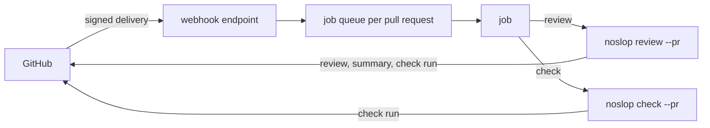

# The GitHub App

noslop posts on a pull request as its own GitHub App and gates the merge with a check run named
`noslop`. For each review, the GitHub adapter posts one pull request review with an inline comment
per new finding, writes one summary comment, and sets the check run. The check passes only when a
review with no failed call ran on the current head and every finding holds a valid disposition,
which the author gives as a typed reply. Every piece of state the App keeps lives in hidden markers
inside its own comments, so each run reads the pull request's state back from GitHub and the server
keeps no database. [0009](../../decisions/0009-the-merge-loop.md) records the merge loop.

The App server runs those reviews: a webhook endpoint, a queue of jobs per pull request, and jobs
that run the noslop CLI.



[Reporters](./reporters.md) covers why the `github` reporter runs after the others, and
[the CLI](./cli.md) covers the commands the jobs run.

## The App server

The server is an Elysia app in the `apps/github-app` package. Its webhook endpoint checks each
delivery's signature against the App's webhook secret and refuses an unsigned or wrongly signed one.
A delivery the App acts on goes to the queue, and the endpoint answers at once, because GitHub
counts a delivery as failed when the answer takes longer than its short timeout.

The App acts on two kinds of event, and leaves every other delivery be:

- A pull request opened, synchronized, reopened or marked ready for review queues a review job. A
  draft queues nothing.
- A new review comment or a new comment on a pull request queues a check job, so a person's reply
  changes the check without a new review.

A comment that a bot wrote is dropped, the App's own included, so the comments a job posts never
start another job. A pull request that a bot opened or pushed is reviewed, because agents open most
of the pull requests noslop reviews. An edited or deleted comment queues a check like a new one,
since an edit can change a disposition.

The queue runs the jobs of one repo one at a time, in the order they came, because the jobs share
the repo's clone and two reviews of one pull request must never read the same state and post at
once. Jobs of different repos run side by side. A failed job is logged, and the next job still runs.
The queue lives in the server's memory, so a restart drops the jobs it held; the next push or
comment queues a new one.

A review job mints an installation token for the App, clones the repo into the server's repos folder
or fetches it when the clone exists, fetches the pull request's head, checks out the default branch,
and runs `noslop review --pr <number> --repo <owner/name> --report sqlite,github` in the clone. The
CLI reads the review config from the pull request's base commit. The token reaches git through git's
environment config, so it never appears in a command line that other processes can list or in the
clone's config file. A check job runs `noslop check --pr <number> --repo <owner/name>`. Each job
passes the App's credentials and the event's installation to the CLI through its environment.

The reviewed repo's code never sees those credentials. A job runs the CLI under noslop's own Bun
config, so Bun loads no preload from the repo, and the CLI removes the App's keys from its process
environment before it spawns a model CLI or git. The server reads the App's id, private key, webhook
secret and repos folder from its environment, and refuses to start when one is missing.

## What a review posts

The `github` reporter needs a pull request, and it reads the pull request's state from GitHub before
it posts anything.

1. It posts one pull request review at the reviewed head, which is the commit the review ran
   against, with one inline comment per new finding at the finding's anchor. A finding is new when
   no finding comment or filed follow-up holds its id, so a finding that a re-review reports again
   keeps its first thread. Each comment opens with the severity, the lens and the title, then the
   body, the fact a PLAUSIBLE finding rests on and the fix. The accepted disposition forms and the
   finding id with its lens, criterion and rule sit in collapsed blocks, so a person reads the
   finding first. The finding marker comes last.
2. When GitHub refuses the review because a line sits outside the diff, the reporter posts each
   comment on its own. A finding GitHub still refuses goes into an issue comment on the pull request
   that names its anchor. A person answers it with an issue comment that starts with the finding's
   id.
3. After the one re-check, a new finding that is no security finding and sits in code the change did
   not write goes to a follow-up issue in the repo instead of the pull request. The summary marker
   keeps each filed id, so a later review files the issue once.
4. It edits the comment of each finding whose fix the review confirms: it strikes the heading
   through, names the fix commit, and collapses the comment as posted under them, with the marker
   kept byte for byte. When a later review no longer confirms the fix, the reporter restores the
   comment as posted.
5. It writes the summary comment, which it creates on the first review and edits in place after
   that. The summary opens with the count of the findings this review reports and a risk level: high
   with any P1 or risk-class finding, medium with any P2, and low otherwise. A review with a failed
   call says it is partial. On a re-review the summary lists whether each `fixed` finding is fixed,
   and its headline says all findings are fixed only when every finding an earlier review posted
   holds a confirmed fix. A table links each finding to its comment, and the reviewed head and base,
   the depth, the lenses, a special change and each failed call sit in a collapsed block.
6. It sets the check run.

## State in markers

Each comment the App posts ends with a hidden HTML comment that holds its kind and its state as
JSON, with every `>` escaped, so no title or reason can end the marker early. A finding marker holds
what the check needs to judge a disposition without the review result: the id, title, file, lens,
severity, risk class, and whether the change wrote the code. The summary marker holds the reviewed
head, the number of reviews so far, the ids that review reported, its count of failed calls, the
filed follow-ups and the confirmed fixes. A forms marker, on the App's answer to a free-text reply,
holds the id of the reply it answered.

Only a comment by the App's own login holds state. The adapter reads that login from GitHub's
endpoint for the authenticated App when it connects, and treats a comment by anyone else, other bots
included, as a reply, because anyone can paste a marker into a comment. With no App credentials in
the environment, the connection reads GitHub anonymously and trusts no comment. A finding comment of
the App whose marker noslop cannot read fails the check, so a damaged marker never drops a finding
from the gate.

## Dispositions

A disposition is the typed answer to a finding: `fixed`, `not-a-defect`, `deferred` or
`accepted-risk`. The author answers a finding in its thread, or in an issue comment that starts with
its id for a finding outside the diff. The reply's first line is the disposition, and the finding's
latest disposition counts:

```text
fixed 1a2b3c4
not-a-defect the caller already holds the lock
deferred #123
accepted-risk single-tenant deploy; no shared rows
```

A reply in any other form is no disposition. Each time noslop sets the check, it answers each such
reply once with the accepted forms, and the forms marker stops a later run answering it again. Each
kind is valid under its own rule:

- `fixed <commit>` is valid when the sha names exactly one commit on the branch and a re-review that
  read the commit no longer reports the finding.
- `not-a-defect <reason>` is valid with any reason.
- `deferred <issue>` is valid when the change did not write the code, the finding is no P1, security
  or risk-class finding, and the issue exists. The issue is `#<number>` in the same repo,
  `<owner>/<repo>#<number>`, or an issue URL.
- `accepted-risk <reason>` is valid when the author has admin permission on the repo.

A finding in code the change wrote therefore takes `fixed`, `not-a-defect` or `accepted-risk`,
because the pull request fixes the code it wrote rather than deferring it to a later one.

## Re-review and fix confirmation

A re-review is a later review of a pull request, and it covers only the commits since the reviewed
head of the last fully completed review. The CLI reads the summary marker, and when that review had
no failed call, differs from the current head and is an ancestor of it, its head becomes the base.
Otherwise the base is the merge base of the pull request, and the review covers the whole change. A
review with a failed call therefore never narrows the next one, and a force push that drops the
reviewed head brings a full review.

A re-review leaves the pull request's description unjudged. Its title and body describe the whole
pull request, while its diff holds only the new commits, so a file the body names can look missing
from that diff. The prompt of each re-review call therefore asks the lenses to report no mismatch
between the description and the diff, and a full review judges the description.

A `fixed <commit>` disposition counts once a re-review whose range holds that commit no longer
reports the finding. The commit may change any file, because a fix such as a missing test lands
beside the finding's file. The commit must also come after the head of the review that posted the
finding, which the finding's marker keeps, so a full review over the whole branch never confirms a
fix through an older commit. The summary marker keeps each confirmed fix as the finding id and the
commit, so a later delta without the commit keeps the confirmation. A fix that a re-review still
reports stays unconfirmed, and a later delta without the commit leaves it unconfirmed. The re-review
reads the dispositions present when it runs, so a `fixed` reply posted after the re-review of its
commit finds no review that read it, and the check keeps the finding open.

The re-check is the second review of a pull request. From the third review on, the reporter sends
each new finding in code the change did not write to a follow-up issue. A security finding, and any
finding in code the change wrote, goes on the pull request at every review.

## The check run

The check passes when all of these hold, and fails otherwise:

- The summary marker's head is the current head of the pull request.
- No call of that review failed.
- No reporter that ran before the `github` reporter failed.
- Every finding comment of the App holds a marker noslop can read.
- Every finding, P3 included, holds a valid disposition.

The check's title states the first problem, and its text lists each finding with no valid
disposition and the reason. The `github` reporter sets the check after each review, and
`noslop check --pr <number> --repo <owner/name>` sets it again from what GitHub holds, with no new
review. The command exits 0 whatever the check concludes, because a failing check is an answer, not
an error. A reporter failure lives only in the run that saw it, so a later `noslop check` judges the
pull request without it.
