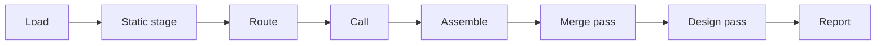

# Pipeline

A review turns the change between two commits into a list of findings. It reads the change through
git, runs the static stage over it, routes the change to the lenses that fire, sends those lenses to
a model in calls, and assembles what comes back into findings. Every fact a model needs and code can
compute comes from the static stage first, under [0002](../../decisions/0002-the-pipeline.md), so
the model calls spend their tokens on judgement. The review module runs these stages; the CLI and
the [GitHub App](../output/github-app.md) only supply the change and hand the result to
[reporters](../output/reporters.md).

## The stages

1. **Load.** The CLI finds the repo, merges [the reviewer config](../config/review-config.md) and
   reads the rules file. It resolves the base and the head to full commits, and reads the diff
   between them with the files the config marks generated left out. Every line reference in the
   review cites the head commit.
2. **Static stage.** [The static stage](./static-stage.md) reads the changed files at the head,
   builds the slices, reports the direct findings and computes the risk signals. It runs on every
   change, because it makes no model call and routing reads its output even when no code changed.
3. **Route.** [Routing](./routing-and-depth.md) picks the lenses that fire, the depth, and the calls
   that carry them, from the static stage's output alone, so two runs on one change route it the
   same way.
4. **Call.** For each planned call, the [lenses](./lenses.md) build one prompt, and the
   [adapter](./adapters.md) sends it to a model CLI. The calls run at the same time, up to the
   config's parallel limit, and the review keeps their records and findings in the planned order,
   whatever order they end in. A call that fails is retried once on the same adapter. A call that
   fails again is recorded as failed, and the review goes on with the rest.
5. **Assemble.** The findings module turns the raw output of every call, with the static stage's
   direct findings, into [findings](./findings.md): it drops a finding that breaks the finding rules
   and merges two reports of one defect whose titles hold the same words.
6. **Merge pass.** One call on a cheap model reads the assembled findings, with no code, and returns
   the groups of findings that report one defect. In each file a group spans, the review keeps the
   group's finding with the highest severity, so the pass removes a repeat and never a finding that
   no other finding still reports. One defect reported in two files keeps both, because each anchor
   shows the reader a place to fix. Lenses word one defect differently, and only a model tells a
   reworded repeat from two defects whose titles differ by one word. The pass runs when the config
   turns it on and the review holds at least two model findings. Each adapter's options name its
   model. When the call fails, the findings stay unmerged and the review is not counted as failed,
   because a repeat costs the reader less than a lost finding.
7. **Design pass.** On every review of a pull request after its first, one call runs
   [the design lens](./lenses.md#the-design-lens), which asks whether a better approach meets the
   task the pull request states. A first review runs no design pass, because a single round of
   findings shows no repeated patching. Assemble checks the pass's finding against the whole pull
   request, and the review keeps at most one. The pass runs when the config turns it on. When the
   call fails, the review keeps the other findings and is not counted as failed, as with the merge
   pass, because the lens calls still covered the head.
8. **Report.** The CLI prints the result, as JSON or as a summary, and runs each reporter the config
   lists, or the ones its flag names.

The calls read a detached git worktree of the head commit, so a model that opens a file sees the
reviewed code and never the user's working tree. The review creates the worktree only when the route
holds a call or the design pass runs, and removes it after the design pass, whether the calls pass
or fail. A worktree that git cannot remove is logged for the user to prune.

Lint runs in the repo's own checks before a review, so noslop never runs lint and never repeats a
rule that lint enforces. The lenses whose concerns overlap lint tell the model to report no rule the
repo's lint config enforces.

## Depth

The depth that routing picks sets the effort of every call, and every depth makes one pass of the
planned calls under [0007](../../decisions/0007-depth-and-models.md).
[Routing and depth](./routing-and-depth.md#the-pass) covers why a review never changes its depth.

## The result

The review result holds the commits, the depth, the special route if any, the marked risk classes,
the fired lenses that a call ran, a record of every call, the findings, the failed calls, and a hash
of the merged config and rules text. The record of each call holds its lenses, depth, model, effort,
attempts, tokens and duration, so the [findings store](../measurement/store.md) and the
[eval harness](../measurement/eval.md) can price a review and tell which call found what. The
contract package holds the schema, and its version changes only with a breaking change, so a
consumer that pins a CLI version reads one shape.

A review with a failed call still returns a result, with the call listed under its failed calls. A
re-review of a pull request starts from the last head whose review had no failed call, because a
review with a failed call never covered its head in full. [The CLI](../output/cli.md) covers how a
re-review picks its base.
