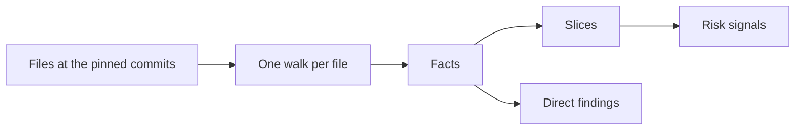

# The static stage

The static stage computes, with no model call, every fact about a change that code can compute,
under [0002](../../decisions/0002-the-pipeline.md). It runs before any model call, so each such fact
is computed once and every call reads it from the stage. It reads the changed files at the head
commit, parses each TypeScript or JavaScript file once with oxc, and walks each syntax tree once
with every collector reading every node. It then cuts the facts down to three outputs: the slices
that the lenses read, the direct findings it reports itself, and the risk signals that
[routing](./routing-and-depth.md) reads. A fact the stage computes costs nothing per run and gives
the same answer every run, so the model calls spend their tokens on judgement.

## Reading the change

Every read goes through git at a pinned commit, so the stage never depends on the state of a working
tree. The stage reads each changed file at the head, every package manifest at the head, and a set
of context files: the test files beside each changed source, and every instruction file when an
instruction file changed. A context file feeds the checks that compare against it, such as a
duplicate test body or a rule repeated in another instruction file, and a direct finding never
anchors to one. At the base commit, the stage reads only the changed manifests and the deleted code
files, because a version bump and an export that leaves with its file are the facts that need the
base side.

Only TypeScript and JavaScript files get a syntax tree. Every other file, code in other languages
included, yields only the facts a path and a diff show: its kind, its changed lines, and whether it
is a migration, an infra file, prose or an instruction file. A file with syntax errors still yields
the tree oxc recovered.

The stage sorts each changed path into a kind, from the config's path globs for instruction, infra
and prose files and from the extension for code, tests and config. Instruction files come before
prose, because an agent instruction file is also Markdown. A file with no known extension whose
first line is a shebang is code, so an executable script fires the correctness lens. Routing and the
lenses read the kind to decide which hunks a lens sees.

## Slices

A slice is the part of the stage's facts that one lens concern reads, such as the new writes or the
new throws, and the contract package (`@noslop/contract`) holds its shape. The stage keeps a fact
only when it touches the change: the functions a changed line falls in, the guards, throws and
config reads on added lines, every write in a changed function so a lens sees the writes a new one
sits beside, and the security facts on touched lines. [The lenses](./lenses.md) covers which lens
reads which slice.

The stack patterns in [your own rules](../config/your-own-rules.md) decide what counts as a write,
an I/O call, an event, a transaction, an invariant or a request-path call. The stage matches each
call against them by name and by import source, so it learns a stack's meaning without loading its
code.

A guard's condition is traced back through its declarations a step or two, to whether the value
comes from a parameter, a call, a constant or the function's own state. The failure-handling lens
needs that origin to tell an input check from an assertion of a bug-only condition.

The edge slice lists each changed export, schema bound and manifest whose package another package
uses: a workspace package that depends on it, or a consumer in the config that pins it. A change
that nothing consumes holds no edge, so the cross-repo lens stays off.

The type-claim slice lists each line that the change adds to code or a test with a type the checker
cannot confirm: a disable comment for one of the config's
[cast rules](../config/your-own-rules.md#cast-rules), an `any` type, and a `JSON.parse` call. The
stage reads no types, so `JSON.parse` is the one call it knows returns `any`. A disable comment
counts only on a line the change adds, so a cast that keeps an older comment stays out of the slice.
An `as const` assertion and a `satisfies` expression keep the check on, so the slice skips them. Any
entry fires the naming-shape-and-comments lens.

The script slice lists each code file the change adds under the config's script globs that the repo
never runs again. A script counts as run when a package.json script at the head commit names its
path from that package's folder, or a workflow file there names its path from the repo root or a
package's folder. The match takes the whole path, so a command that names a longer path keeps the
script in the slice. Any entry fires the naming-shape-and-comments lens, which reads the script and
reports one that ran once only under a rule in the rules file. A git hook or a task runner that runs
the script is left to the lens, which checks before it reports.

### The reuse slice and the base index

The reuse slice gives each new function the base functions closest to it. Half of a candidate's
score is the overlap of the two functions' name tokens, and half is the overlap of their calls and
literals. A function with no candidate at the configured minimum score is left out, so the reuse
lens fires only on a real match.

The candidates come from the base index: every exported function at the base commit, with its name,
its place and its fingerprint of calls and literals. The stage builds the index only when the change
adds a function, because building it parses every code file at the base. It caches the index in the
user's cache folder under a key built from the base commit and the stack patterns, so a change to
the patterns rebuilds it.

## Direct findings

A direct finding is a finding the stage reports with no model call. The stage reads its defect from
the code, so it is CONFIRMED and carries the lens `static`, as [findings](./findings.md) describes.
A check that reports a missing change, such as a missing version bump, anchors to the code that
needs it. The stage reports:

- Defects in tests: a new test with no assertion, a new test whose body repeats another test's, a
  type test on a key its type lacks, a new allow-or-deny check whose tests hold no table of hostile
  inputs, and a test file the pull request body names that the change neither adds nor edits.
- Defects in instruction files: a new rule sentence that another instruction file loaded beside it
  already holds, and a new rule with wording that leaves an agent the choice.
- Defects in the change as a whole: a version bump that a consumer's range refuses, a schema bound
  above the published limit the config names, an edit to a synced copy outside a sync, a format-only
  hunk in a file the linked issue does not name, and a public package that changes paths the config
  ties to a version bump without bumping its version.

The synced-copy check skips a synced workflow file, edited in place, whose only change moves the ref
of a job's `uses:` call to a workflow in another repo, because the sync that delivers such a caller
pins the call to its own ref. The check parses both versions as YAML to find which values changed,
and it compares the changed lines as text, because a parse drops comments.

The synced-copy check also skips a pull request that an account in the config's sync authors opened.
A sync can change files outside the synced paths, such as a manifest or the repo's config, and those
files keep the change from routing as a sync, so the lenses still review them. The check matches the
GitHub login of the account that opened the pull request, so a local review, which has none, always
runs it.

The review takes the linked issue and a reader for consumer manifests from its caller. The CLI takes
the linked issue from `--issue-file` when it is given, so an issue that lives outside GitHub reaches
the review with no tracker code in noslop. Without it, a review of a pull request reads the GitHub
issue that its body closes, and a local review links no issue. The CLI passes no reader, so the
consumer-range check reads only the manifests in the repo itself.

## Special changes and risk signals

The stage tells routing whether the change is a sync or a release bump. A sync touches only the
paths the config marks synced. A release bump touches only changelogs and package manifests whose
only difference from the base is the top-level version.

The risk signals are the facts routing reads to fire lenses and pick the depth: the marked risk
classes, the detectors that fired, the number of packages touched, the consumer edges, the changed
and deleted lines, a breaking marker in the title or body, and the changed files with a past escape.
A risk class is marked when a changed path matches its globs or one of its detectors fires on a
slice, as [your own rules](../config/your-own-rules.md) describes. The CLI reads the past escapes of
the repo from [the findings store](../measurement/store.md).
