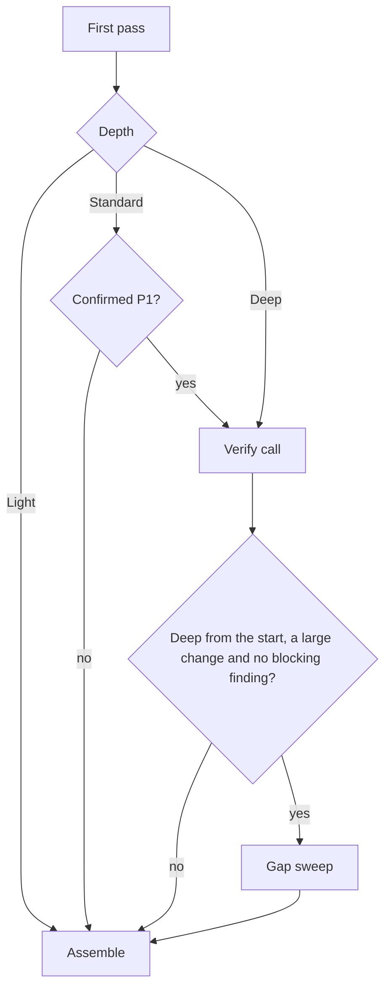

# Routing and depth

Routing decides, for one change, which lenses fire and how hard the review looks. It reads only what
the [static stage](./static-stage.md) produced: the changed files, the slices, the risk signals and
the config. No model takes part, so 2 runs on one change fire the same lenses at the same depth.
[0006](../decisions/0006-routing.md) records the triggers and the special changes, and
[0007](../decisions/0007-depth-and-models.md) records the Light and Deep rules. Routing then plans
the calls that carry the fired lenses, which [calls](./calls.md) covers.

## Special changes

A few kinds of change route on a lens list of their own in place of the triggers. Routing checks
them in order, so a change that is both a sync and a release routes as a sync, and each change gets
the narrowest route that covers it.

| Change      | When                                               | Lenses                         |
| ----------- | -------------------------------------------------- | ------------------------------ |
| sync        | every changed file is under a synced path          | none                           |
| release     | only changelogs and manifest version bumps change  | none                           |
| docs-only   | every changed file is prose or an instruction file | documentation and instructions |
| direct-push | the caller reviews a push to the default branch    | the triggers                   |

A sync or a release fires no lens, so its review holds only the static stage's findings, and the
review makes no worktree and runs no model. The source change of a sync carries its own review, and
a release bump changes no behaviour. A docs-only change fires the documentation lens on any prose it
changes, whatever its size, because documentation is the lens that change exists for. A direct push
fires lenses by the triggers like any other change, and the result marks it as a direct push.

## Firing a lens

The correctness lens fires on every change that holds a code or test file. Each other lens fires
when its trigger matches, and each trigger reads only slices and changed paths, so a lens fires only
when its input holds something to look at. Several triggers compare a slice with a threshold from
the config, such as the number of writes that fires the concurrency lens.

A marked risk class fires every lens it forces on, whatever the triggers say.
[Your own rules](./your-own-rules.md) covers how a risk class is marked. A special change with a
lens list of its own ignores forced lenses, because its list is the whole route.

A lens that the config turns off never fires. One exception: a lens that a marked risk class forces
on fires even when the config turns it off, because the risk class is the stronger statement about
the change.

The fired lenses keep the lens set's own order, so a call's prompt holds its sections in one order
on every run.

## Picking the depth

Routing checks Deep first, then Light, and every other change is Standard. Depth sets the default
effort of each call: low at Light, medium at Standard and high at Deep. Every threshold comes from
the config.

A change is Deep when it marks a risk class, touches the configured number of packages or more,
carries a breaking marker, or hits a consumer edge in another repo. A deletion in any path that a
risk class forces a lens on also makes it Deep, whether or not the class's detectors mark it,
because a deletion there is the change most likely to break what the class protects.

A change is Light only when every one of these holds:

- No static risk slice fires: no security slice, no migration, and no set of writes that would fire
  the concurrency lens.
- It touches at most one package and no consumer edge.
- It is small: its code lines are within the Light limit, or it changes only tests, or only prose
  and instructions.
- No file in it has a past escape.

The Light line count leaves out prose and instruction files, and the static stage leaves generated
files out of the change before routing reads it, so neither kind can push a change past Light.

## The passes

The review module runs the planned calls in passes, and the depth decides which passes run.

A CONFIRMED P1 at Standard steps the review up to Deep once: the review module runs only the verify
call on the findings the Standard pass has, and runs no call again. The result holds the depth it
stepped up from.

A Light review never steps up. A P1 that a Light review finds stays in its result, and the
[eval harness](./eval.md) counts the labelled P1s and escapes that its Light cases hold, so a Light
rule that lets P1s through shows up on the corpus.

The verify call is 1 call over every model finding of the first pass, after the merge, with the
lenses of those findings and a closing task to re-derive each one from the code. Its findings
replace the first pass's model findings. When the verify call fails, the first pass's findings stay,
so a verify failure never loses a finding.

The gap sweep runs on a review that routed to Deep, on a large change, one with at least the
configured number of files or of changed lines, when no blocking finding survives the verify call. A
blocking finding is a P1, a security finding or a risk-class finding. The sweep is 1 call with every
fired lens and the findings so far, and it asks only for defects they miss, because a change with a
blocking finding cannot merge, and the sweep spends its effort where the review would otherwise
pass.

Each pass runs every call through the adapter, retrying a failed call once, under
[adapters](./adapters.md). [Findings](./findings.md) covers how Assemble merges the findings of
every pass.
