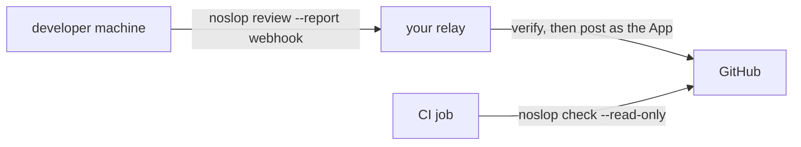

# Enforce a review with a relay

Each developer runs the noslop review on their own machine, under their own model seat, and a relay
that your org writes posts the result on the pull request as your GitHub App. CI then runs
`noslop check --read-only` with the job's own token. The check reads what the App posted, makes no
model call and writes nothing to GitHub, so a pull request cannot merge until a review of its head
is posted and every finding holds an answer. noslop decides whether a result is valid; your relay
owns the transport, the identity, the hosting and any policy on top.



You need a GitHub App installed on the repo, as [set up a repo](./set-up-a-repo.md) describes, and a
place to host the relay. Only the relay holds the App's keys; a developer's machine and the CI job
never do. Without the App's keys, a review reads the pull request through GitHub's API with the
developer's `GH_TOKEN`, or `GITHUB_TOKEN` when `GH_TOKEN` is unset. On a public repo, a review with
neither token reads the pull request anonymously. Your org issues the token: noslop stores none and
runs no login.

## Send each review to the relay

1. Add the webhook reporter and your App's slug to the repo's `review.json` on the default branch:

   ```json
   {
     "github": { "app": "<app_slug>" },
     "reporters": {
       "webhook": {
         "url": "https://relay.example.com/noslop",
         "secretHeader": "x-relay-secret",
         "secretEnv": "NOSLOP_RELAY_SECRET"
       }
     }
   }
   ```

   [Reporters](../architecture/output/reporters.md) covers the options. The secret stays in each
   developer's environment, out of the config file. The slug is the name in the App's URL,
   `https://github.com/apps/<app_slug>`. A developer's review trusts only the comments of
   `<app_slug>[bot]`, so it runs as a delta from the App's last summary, drops a finding answered
   `not-a-defect`, and confirms a fix. The App's own reviews refuse a slug that names another App.

2. On a developer's machine, set `NOSLOP_RELAY_SECRET` and `GH_TOKEN`, and review the pull request:

   ```bash
   noslop review --pr <number> --report webhook
   ```

   Expect exit code 0 once the relay answers with a success status. A review without `--pr` covers
   no pull request, so the relay refuses it.

## Write the relay

The relay authenticates the request, verifies the result, posts it as the App, and answers 200. The
example uses `@noslop/cli/verify` and `@noslop/cli/post`, and reads the App's keys,
`NOSLOP_GITHUB_APP_ID`, `NOSLOP_GITHUB_APP_PRIVATE_KEY` and `NOSLOP_GITHUB_APP_INSTALLATION_ID`,
from its own environment:

```ts
import { timingSafeEqual } from 'node:crypto';
import { sendResult } from '@noslop/cli/post';
import { verify } from '@noslop/cli/verify';

const secret = Buffer.from(process.env['NOSLOP_RELAY_SECRET'] ?? '');

function isAuthentic(request: Request): boolean {
  const given = Buffer.from(request.headers.get('x-relay-secret') ?? '');

  return secret.length > 0 && given.length === secret.length && timingSafeEqual(given, secret);
}

Bun.serve({
  port: 8080,
  fetch: async (request) => {
    if (!isAuthentic(request)) {
      return new Response('unauthorized', { status: 401 });
    }

    try {
      const result = await verify(await request.json(), { env: process.env });

      await sendResult(result, { env: process.env, verify: false });
    } catch (error) {
      return new Response(String(error), { status: 422 });
    }

    return new Response('posted');
  },
});
```

`verify` refuses a result that reviews a commit other than the pull request's head, and a result
whose config hash differs from the config on the base branch, so a stale review or one under another
config never posts. [Verifying a result](../architecture/output/cli.md#verifying-a-result) covers
the check. A relay without that code can run the same steps with `noslop verify <file>` and
`noslop post <file>`.

Post every result from one relay process, one result at a time. noslop runs the posts for one pull
request in turn inside a process, and nothing orders posts across processes, so two processes that
post one review at once can each file the same follow-up issue.

## Gate the merge in CI

The relay's `post` sets the `noslop` check run when it posts a review, and a required CI job gates
the merge. The job runs a read-only check with its own `GITHUB_TOKEN`, so CI never holds the App's
keys. A branch that edits the workflow can read every secret the job holds, and with the App's keys
it could post a review as the App.

1. Give the job's token read access to the pull request:

   ```yaml
   permissions:
     contents: read
     pull-requests: read
     issues: read
   ```

2. Run the check on each pull request, and on each comment on one, so an answer to a finding re-runs
   it:

   ```bash
   noslop check --read-only --pr <number> --repo <owner/name>
   ```

   Set `GITHUB_TOKEN` in the step's environment to `${{ github.token }}`.

3. Make the job required in the branch rules.

The check trusts only the comments of the App that `github.app` names in the config on the base
branch, so it refuses to run while that config names no App. Until a review covers the pull
request's net change at the head, the job prints `noslop: no noslop review for this commit` and
exits 1. A review of an earlier head covers it when a clean rebase or a merge of the base left each
file's patch as the review read it. Once a review covers it, the job prints the outcome and each
open finding, and exits 0 only when the check passes. The check passes once that review ran with no
failed call and every finding holds a valid answer, as [answer a finding](./answer-a-finding.md)
describes.

Leave the `noslop` check run out of the branch rules. The relay sets it only when it posts, and an
answer to a finding sets nothing, so the check run shows the state at post time. Require it only
when your relay also runs `noslop check` with the App's keys on each comment webhook, as
[the GitHub App](../architecture/output/github-app.md) does.
